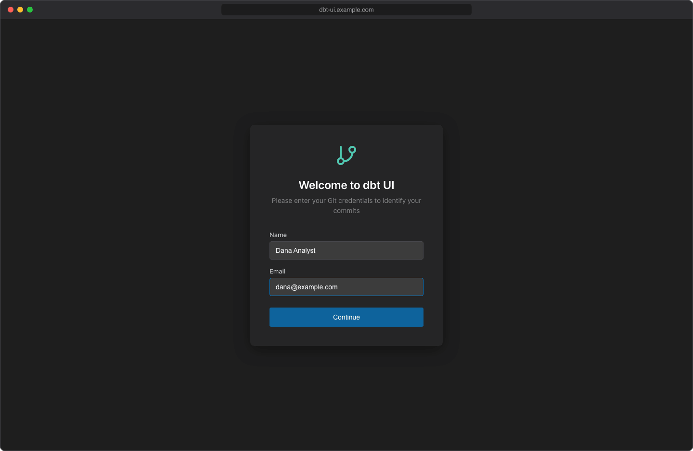
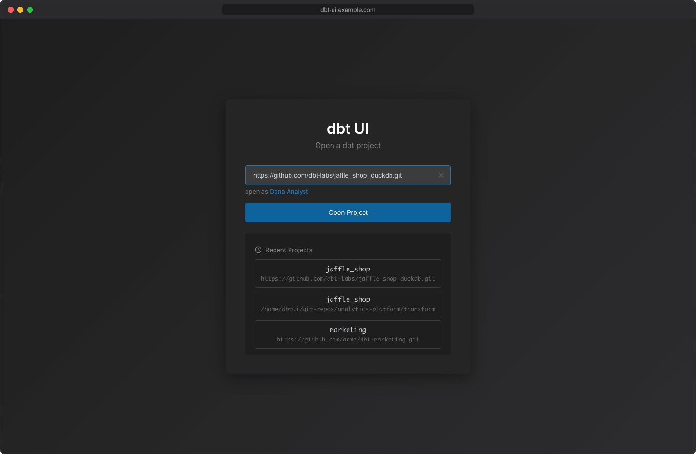

# Open your first project

This page walks you through the first visit to dbt UI: telling it who you are, opening a dbt project from git, and setting up the Python environment that runs dbt.

## Before you start

Check that your dbt project meets these requirements:

- **It's in a git repository.** dbt UI opens projects either by cloning a git URL or from a repository that's already on the server.
- **`profiles.yml` is in the project folder**, next to `dbt_project.yml`. dbt UI runs dbt with `--profiles-dir` pointing at the project folder, so a `profiles.yml` in `~/.dbt` isn't used. Keep passwords out of it with [`env_var()`](../using/env-vars.md).
- **Your dbt adapter is in a `requirements.txt`** in the project folder (for example `dbt-postgres` or `dbt-snowflake`). dbt UI doesn't contain dbt-core or any adapter: it installs the versions your project asks for from PyPI (see [step 3](#3-create-the-virtual-environment) below).

## 1. Set your git identity

The first time you open dbt UI in a browser, it asks for your **Name** and **Email** ("Welcome to dbt UI"). Enter them and click **Continue**.

dbt UI uses your identity to:

- author your commits,
- name your personal branch and workspace (see [Your personal workspace](#your-personal-workspace)),
- show who started a run in the [scheduler](../scheduler/index.md).

Your identity is stored in this browser only (local storage), not on the server. If you use a different browser or clear site data, dbt UI asks again.

To change it later, click your name in **open as *your name*** on the project screen. The dialog opens as "Edit Profile"; click **Save Changes**.

!!! warning "Changing your name changes your workspace"
    Your branch and workspace are named after your name. If you change it, the next project you open uses a new branch and workspace, and your previous work stays on the old branch. Use the same name in every browser you use.

## 2. Open a repository

On the "Open a dbt project" screen, enter a git URL or a path in the input and click **Open Project**.

=== "Clone from a URL"

    Enter the repository's URL, for example `https://github.com/your-org/analytics.git`. dbt UI treats the input as a git URL when it starts with `http://`, `https://`, `git@` or `git://`, or ends with `.git`.

    dbt UI clones the repository into its repositories folder on the server (`./git-repos` by default, see [Install with Docker](install.md)). The repository is cloned once and shared by all users; if someone already cloned it, dbt UI fetches the latest changes instead.

    You can paste a GitHub or GitLab page address instead of the clone URL: dbt UI strips page paths such as `/pulls` or `/-/merge_requests` and clones the repository.

=== "Use a repository on the server"

    Enter the path of a dbt project folder on the server, or click the folder button (**Browse folders**) to pick one. The browser starts in the repositories folder and marks folders that contain a `dbt_project.yml` with a **dbt** badge. Open a folder by clicking it, then click **Select Current Folder**.

    The path must contain a `dbt_project.yml`, otherwise you'll see "Not a valid dbt project (dbt_project.yml not found)". The folder can be a subfolder of a repository: dbt UI then opens that subfolder in your workspace.

    The folder browser also lists your recent projects.

The progress bar shows the steps: cloning or validating, then "Setting up workspace...". When it's done, the project opens.

### Private repositories

For an `https://` URL that needs authentication, dbt UI shows an **Authentication Required** dialog:

1. Enter your **Username** and **Password / Token**. For GitHub, use a personal access token, not your password.
2. Leave **Remember credentials** checked to save them for later pulls and pushes.
3. Click **Submit**.

Remembered credentials are kept in a cookie in your browser for 30 days by default (`DBT_UI__BACKEND_GIT_CREDS_COOKIE_MAX_AGE`), one per repository. Next time the dialog offers **Use Saved Credentials (*username*)**. See [Git](../using/git.md#credentials-for-private-remotes) for details.

For `git@` (SSH) URLs, dbt UI doesn't ask for credentials: the backend's own SSH setup has to have access. Otherwise opening fails with "Authentication failed. Check your SSH keys or credentials."

### Repositories with several dbt projects

If the dbt project isn't at the root of the repository, open the folder that contains it with a GitHub or GitLab folder URL:

- GitHub: `https://github.com/your-org/analytics/tree/main/transform`
- GitLab: `https://gitlab.com/your-org/analytics/-/tree/main/transform`

dbt UI clones the whole repository and opens the `transform` folder as the project. The branch name in the URL only identifies the folder: your workspace is still on your own branch.

Other git hosts don't support a folder in the URL. For those, open the project from the server instead: once the repository is in the repositories folder, enter or browse to the project's folder inside it (see **Use a repository on the server** above). dbt UI opens that folder in your workspace.

## 3. Create the virtual environment

Each workspace runs dbt from its own Python virtual environment. When a project has none yet, the **Create virtual environment** button at the bottom of the sidebar glows, and the lineage panel shows "Virtual environment not found."

1. Click **Create virtual environment** in the sidebar.
2. Confirm with **Create**. This can take a few minutes.

dbt UI then:

1. creates the environment in a `.dbt-ui-venv` folder inside your workspace,
2. installs the packages listed in the project's `requirements.txt` from PyPI, if there is one,
3. installs `dbt-core` from PyPI in the version allowed by `require-dbt-version` in `dbt_project.yml`; without it, the version from `requirements.txt` is kept, or the latest is installed if neither sets one,
4. runs `dbt deps`, with your [env vars](../using/env-vars.md), if the project has a `packages.yml` or `dependencies.yml`.

`require-dbt-version` can be an exact version (`"1.8.0"` or `"=1.8.0"`), a range (`">=1.5.0"`) or a list of constraints (`[">=1.5.0", "<2.0.0"]`), all of which must hold. If dbt UI can't read the value, it installs the latest dbt-core.

A dialog shows the output when it finishes. Until the environment exists, the run, test, seed and compile buttons and the **Env Vars** button aren't available.

Use the same button later to rebuild the environment, for example after changing `requirements.txt` or `packages.yml`: it deletes the existing environment and creates it again.

If the project asks for a Python version (`.python-version`, or `requires-python` in `pyproject.toml`), uv downloads that version once and keeps it in the repositories folder (hidden `.dbt-ui/python`), so it survives dbt UI upgrades. Otherwise the environment uses dbt UI's own Python. When an environment can no longer run, because its Python is missing or dbt UI's Python was upgraded to another version, it shows as missing and the button glows again.

!!! tip "Ignore the environment folder in git"
    Add `.dbt-ui-venv/` to your project's `.gitignore`, together with `target/`, `dbt_packages/` and `logs/`. Otherwise these folders show up as untracked changes in the [Git dialog](../using/git.md).

## Your personal workspace

dbt UI never edits the shared clone directly. When you open a project, it creates:

- **a branch for you**, named after your name: `Jane Doe` becomes `jane-doe-main`. It starts from the commit the shared clone has checked out (normally the latest default branch).
- **a git worktree** for that branch, a separate folder on the server in a `worktrees` folder next to the clone.

Everything you do (editing, running dbt, committing) happens in your worktree, so your changes don't affect other users until you push them. If you open the same project again, dbt UI reuses your branch and worktree.

The sidebar shows your current branch under the project name. Hover the question mark next to it to see the path of your worktree.

!!! note
    Workspaces are matched by name. Two people who enter the same name share one workspace, so make sure everyone uses a distinct name.

## Switch projects

Click **Select another project** at the bottom of the sidebar and confirm with **Switch project**. If the editor has unsaved changes, the dialog warns you that they will be lost.

The project screen lists your **Recent Projects** (the last three you opened in this browser). A project is added to the list when it opens. Clicking one fills in its URL or path; click **Open Project** to open it.

When you reload the page, dbt UI reopens the project you had open, as long as it still exists on the server. Both the recent list and the last project are stored in your browser.

## Next

- [Find your way around the project browser](../using/project-browser.md)
- [Set values for env vars](../using/env-vars.md) used in `profiles.yml`
- [Run dbt](../using/running-dbt.md)
