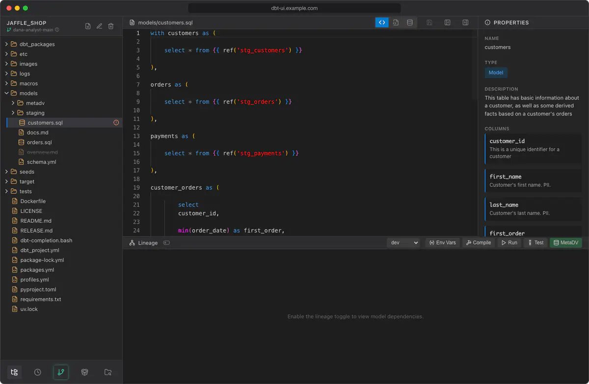

---
hide:
  - navigation
---

# dbt UI

**A web-based user interface for dbt-core projects.** Browse and edit your project, explore lineage, preview data, run dbt, commit to git and schedule jobs, all from the browser, for your whole team, from one Docker deployment.



## What you can do

<div class="grid cards" markdown>

-   **Browse and edit**

    ---

    A file tree of your dbt project and a full code editor for models, YAML, tests and macros. Every user works on their own branch in their own workspace.

    [:octicons-arrow-right-24: Project browser](using/project-browser.md) · [Editor](using/editor.md)

-   **See the data**

    ---

    Preview the rows a model produces without leaving the editor.

    [:octicons-arrow-right-24: Show data](using/show-data.md)

-   **Follow the lineage**

    ---

    An interactive graph of model dependencies, with run, test, seed and compile actions right on it.

    [:octicons-arrow-right-24: Lineage graph](using/lineage.md) · [Running dbt](using/running-dbt.md)

-   **Work with git**

    ---

    See what changed, stage, commit, push, pull and switch branches.

    [:octicons-arrow-right-24: Git](using/git.md)

-   **Schedule jobs**

    ---

    Run dbt on a cron schedule, catch up missed runs, rerun failures, get notified, and see every run on a timeline.

    [:octicons-arrow-right-24: Scheduler](scheduler/index.md)

-   **Model a Data Vault**

    ---

    Map source columns to entities and generate Data Vault 2.0 models with MetaDV.

    [:octicons-arrow-right-24: MetaDV](using/metadv.md)

</div>

## Quick start

```bash
git clone https://github.com/data-diving/dbt-ui.git
cd dbt-ui
echo "DBT_UI__SCHEDULER_ENCRYPTION_KEY=$(openssl rand -base64 32 | tr '+/' '-_')" >> .env
docker compose up --build
```

Then open <http://localhost>. See [Install with Docker](getting-started/install.md) for the options.

!!! note "Git projects only"
    dbt UI works with dbt projects that live in a git repository, cloned from a URL or already on the server.
