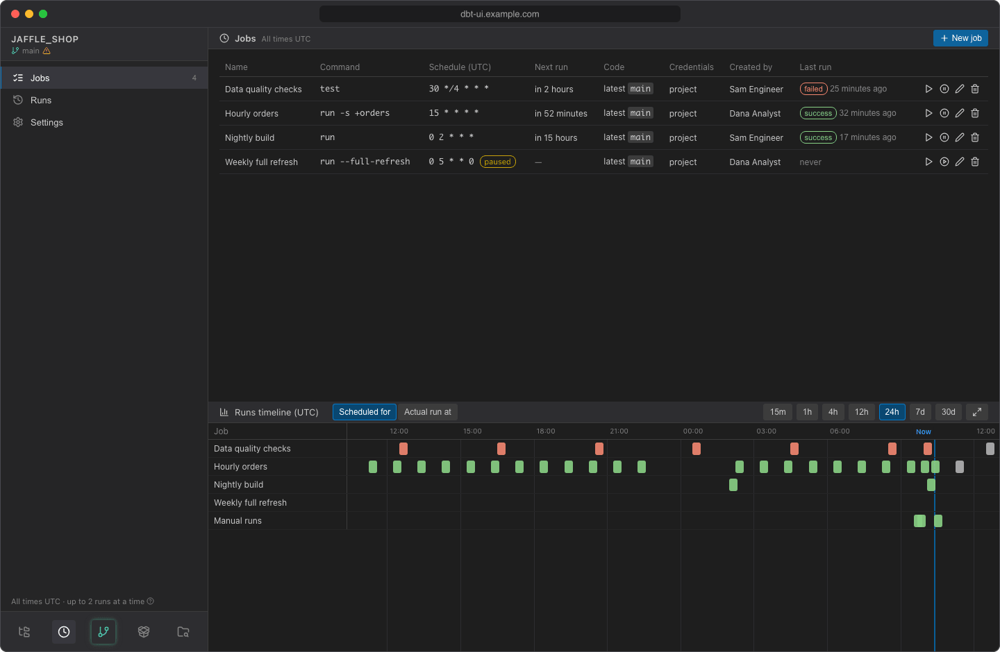

# Scheduler

The scheduler runs dbt commands of your project on a cron schedule and keeps a history of every run: its log, node results, duration, memory and rows affected. It catches up runs that were missed while dbt UI was down, lets you rerun or skip runs, sends a message when a job fails, and draws all runs on a timeline.

It runs inside the dbt UI backend: there is no separate service to install.

## When it is available

The scheduler is on when the backend runs with `DBT_UI__SCHEDULER_ENABLED=true`, which `docker-compose.yml` sets by default. With `docker-compose-without-scheduler.yml` it is off. See [Install with Docker](../getting-started/install.md) and the [configuration reference](../admin/configuration.md).

When the scheduler is off, the clock button in the sidebar is greyed out and its tooltip says why: *Scheduler is disabled*, or *Scheduler unavailable* with the reason (for example while it is still starting).

## Open the scheduler

1. Open a project.
2. Click the clock button (**Scheduler**) in the sidebar toolbar.
3. To get back to your files, click the tree button (**Files and editor**) next to it.

While the scheduler is open, the sidebar shows it instead of your file tree:

| Sidebar item | What it shows |
|---|---|
| Project name and branch | The repository's default branch. The warning icon next to it reminds you that scheduled jobs only run code committed to that branch. |
| **Jobs** | The project's [jobs](jobs.md), with how many there are. |
| **Runs** | The [run history](runs.md). The badge shows how many runs are queued or running, e.g. *2 active*. |
| **Settings** | [Project credentials, failure notifications and all projects](settings.md). |
| Footer | *All times UTC · up to 2 runs at a time*: how many dbt runs the server runs at once (hover the question mark for details). |

The main panel shows the selected page, and the bottom panel shows the [timeline](timeline.md) of the runs.

dbt UI remembers whether the scheduler was open and which page you were on, so a page reload takes you back there. A link to a run, such as the one in a [failure notification](notifications.md), opens the scheduler at that run.

## Shared by everyone in the project

Jobs and runs belong to the dbt project, not to a person. **Everyone who opens the project sees all of its jobs and runs and can run, pause, edit, rerun, skip and delete them, whoever created them.** The same goes for the project credentials and notification channels in Settings.

dbt UI has no roles or per-user permissions (see [Administration](../admin/index.md)). What does depend on the person is whose credentials a job runs with: see [Credentials](credentials.md).

A project here is a dbt project in a git repository: the repository plus the subdirectory the dbt project is in. Each user works in their own workspace of the repository, but they all share the project's jobs and runs.

## Jobs run committed code only

Scheduled jobs always run what is **committed to the repository's default branch** (for example `main`), never uncommitted changes or commits that are not pushed, in your workspace or anyone else's. Each job has its own checkout of that branch and its own Python virtual environment, so scheduled runs never touch the files you are editing.

To get a change into a scheduled job: commit it, push it, and get it onto the default branch. By default a job fetches the latest commit before each run; it can also be pinned to a fixed commit. See [Code source](jobs.md#code-source).

## Manual runs are recorded too

When the scheduler is enabled, Run, Test, Seed and Compile from the editor are executed and recorded by it as well. They still run in your own workspace, with your files as they are, and appear in [Runs](runs.md) as manual runs.

Scheduled and manual runs share one limit on how many dbt runs execute at the same time (`DBT_UI__SCHEDULER_MAX_CONCURRENT`, 2 by default). When the limit is reached, further runs wait in a queue, and the editor keeps waiting while your run is queued. See [Sizing memory and concurrency](../admin/sizing.md) to choose the limit.

## Times are in UTC

Cron schedules and all times in the scheduler are UTC. Lists show times relative to now, such as *5 minutes ago*, *yesterday*, *in 2 hours* or *tomorrow*; hover one to see the exact UTC time. The timeline uses a UTC time axis.

## Next

- [Create a job](jobs.md)
- [Review runs](runs.md) and the [timeline](timeline.md)
- [Missed slots and dbt vars](catch-up.md)
- [Credentials](credentials.md) and [failure notifications](notifications.md)
