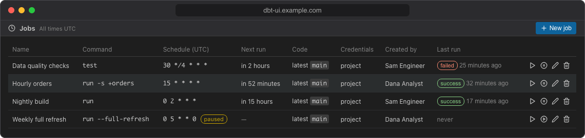
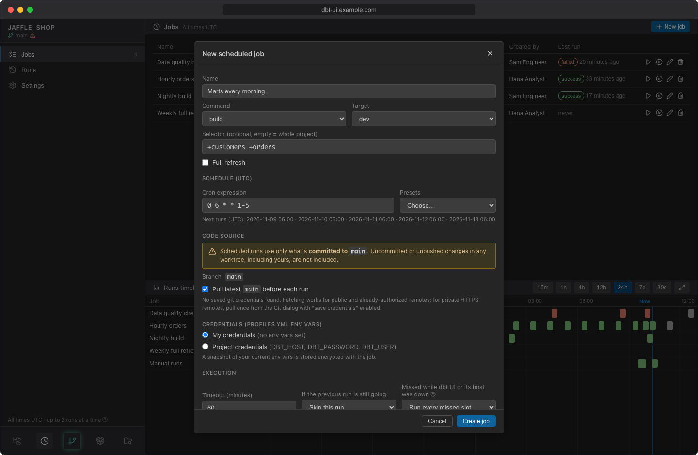

# Jobs

A job is a dbt command with a cron schedule: for example `dbt build --select tag:daily` every day at 03:00 UTC. Open **Jobs** in the scheduler sidebar to see the project's jobs and create new ones.

## The jobs list

| Column | What it shows |
|---|---|
| **Name** | The job name. A spinner means its checkout and virtual environment are being prepared; a warning icon means preparing failed (hover it for the error). |
| **Command** | The dbt command with its selector, `--full-refresh` and target, e.g. `build -s tag:daily (prod)`. |
| **Schedule (UTC)** | The cron expression, labelled *paused* when the job is paused. |
| **Next run** | When the job runs next, e.g. *in 2 hours*. Empty for paused jobs. |
| **Code** | *latest `main`* when it fetches the newest commit before each run, or *pinned* with the commit it always runs. |
| **Credentials** | Whose personal credentials the job uses (e.g. *alice's*; hover for the variable names), or *project*. See [Credentials](credentials.md). |
| **Last run** | Status and time of the job's latest run (skipped runs aren't counted). Click it to open that run. *never* if the job hasn't run yet. |

Click a job's row to open it for editing. The buttons at the end of the row are:

| Button | What it does |
|---|---|
| **Run now** (play) | Starts a run immediately and opens it in [Runs](runs.md). |
| **Pause schedule** / **Resume schedule** | Stops or restarts the schedule, after a confirmation. |
| **Edit** (pencil) | Opens the job form, same as clicking the row. |
| **Delete** (bin) | Deletes the job after a confirmation. Disabled while the job has a run queued or running, or its checkout is being prepared. |

Times in the list are relative to now; hover one for the exact UTC time.

## Create a job

1. Open **Jobs** and click **New job** (or **Create a job** when there are none yet).
2. Fill in the form (see the fields below). Under **Schedule (UTC)**, the form lists the next five times the job will run, so you can check the cron expression before saving.
3. Click **Create job**.

After you save, dbt UI prepares the job's checkout and virtual environment in the background (the spinner next to its name). The job first runs at its **next scheduled time**: creating a job doesn't start a run. Use **Run now** if you want one straight away.

### Fields

| Field | Default | Notes |
|---|---|---|
| **Name** | | Required, up to 200 characters. |
| **Command** | `build` | `build`, `run`, `test` or `seed`. |
| **Target** | The target selected in the editor | Any target of your `profiles.yml`, or *(profile default)*. |
| **Selector** | empty | dbt node selection, e.g. `tag:daily +orders`. Empty runs the whole project. Only letters, digits, spaces and `_ . : + @ * - / ,` are allowed. |
| **Full refresh** | off | Adds `--full-refresh`. Only shown for `build`, `run` and `seed`. |
| **Cron expression** | `0 3 * * *` | A standard 5-field cron expression in UTC: minute, hour, day of month, month, day of week. **Presets** fills in common ones: every 15 minutes, hourly, daily at 03:00, weekdays at 06:00, weekly on Monday at 03:00. |
| **Pull latest `<branch>` before each run** | on | See [Code source](#code-source). |
| **Credentials** | My credentials | *My credentials* or *Project credentials*. See [Credentials](credentials.md). |
| **Timeout (minutes)** | 60 | A run that takes longer is stopped and recorded as failed. At least 1 minute, at most 10080 minutes (7 days). |
| **If the previous run is still going** | Skip this run | See [Overlapping runs](#overlapping-runs). |
| **Missed while dbt UI or its host was down** | Run every missed slot | See [Missed slots and dbt vars](catch-up.md). |
| **Enabled** | on | Untick to create the job paused. |
| **Send to** | Default channel | Where failure notifications go. See [Failure notifications](notifications.md). |

!!! tip "dbt vars"
    Every job run passes the time it was scheduled for to dbt as vars (`dbt_ui_run_datetime` and others), so models can process the data of that slot. See [Missed slots and dbt vars](catch-up.md).

## Code source

Scheduled runs use only what is **committed to the repository's default branch**. Uncommitted or unpushed changes in any workspace, including yours, are not included. The form shows the branch under **Code source**.

You have two options:

- **Pull latest `<branch>` before each run** (default): before every run, the job fetches the default branch from the remote and runs its newest commit. If the fetch fails, the run fails with git's error in its log.
- **Pinned commit**: untick the option and the job always runs one commit. When you save, it is pinned to the latest commit of the default branch; the form then shows that commit (*Always runs commit … — subject (author)*). To move it to a newer commit later, tick **Pin to latest `<branch>` on save** and save.

Fetching from a private HTTPS remote needs git credentials. If you have none saved, the form says so: pull once from the [Git](../using/git.md) dialog with "save credentials" enabled, then save the job. The job keeps a copy of them; see [Credentials](credentials.md#git-credentials).

Each job has its own checkout and its own Python virtual environment. The environment is only rebuilt when `requirements.txt` or `require-dbt-version` in `dbt_project.yml` changes, and `dbt deps` only runs again when `packages.yml`, `dependencies.yml` or `package-lock.yml` changes. This happens at the start of a run and is written to the run's log.

## Overlapping runs

**If the previous run is still going** decides what happens when a run is due while the same job is still running (or waiting in the queue):

- **Skip this run**: the new run is recorded as skipped, with the reason *the previous run of this job is still in progress*. This also applies to **Run now**.
- **Queue it**: the new run waits and starts when the previous one finishes.

Runs of the same job never run at the same time. Reruns, and several missed slots caught up together, always wait for the job's earlier runs, whatever this setting.

## Run now

**Run now** starts a run right away, with the job's current settings, and opens it in [Runs](runs.md). It works for paused jobs too. The run's slot (the time passed to dbt) is the moment you started it. Like every run, it waits in the queue when the server is already running as many dbt runs as it allows.

## Pause and resume

Click **Pause schedule** and confirm to stop a job running on its schedule. A run in progress is not stopped, and **Run now** still works. Paused jobs are labelled *paused* in the list.

While a job is paused, each of its scheduled times is recorded as a skipped run. Tick **Skipped** in [Runs](runs.md) to see them; you can rerun them later to backfill those slots.

Click **Resume schedule** and confirm to start the schedule again. The job runs from its next scheduled time; the times it missed while paused are not run automatically.

Pausing and resuming don't change whose credentials the job uses (see [Credentials](credentials.md)).

## Edit a job

Click the job's row (or the pencil). The form is the same as for a new job; click **Save** to apply your changes.

- **Changing the cron expression** schedules the next run from now. Missed slots of the old schedule are never caught up.
- **Saving a change replaces the job's stored credentials with yours**: your env vars when the job uses personal credentials, and your git credentials when it pulls the latest commit. If the job fetches from a private repository and you have no git credentials saved, the change is refused until you save them in the Git dialog. Saving without any change keeps the stored credentials. See [Credentials](credentials.md).
- A change takes effect from the next run. Runs already queued use the job's current credentials and timeout when they start, but keep the command, selector and target they were created with.

## Delete a job

Click the bin icon and confirm. The job and its checkout are removed; its **run history is kept**. You can't delete a job while it has a run queued or running, or while its checkout is being prepared: wait for it to finish, or cancel the run in [Runs](runs.md) first.

Runs of a deleted job stay in the list, but can't be rerun.
