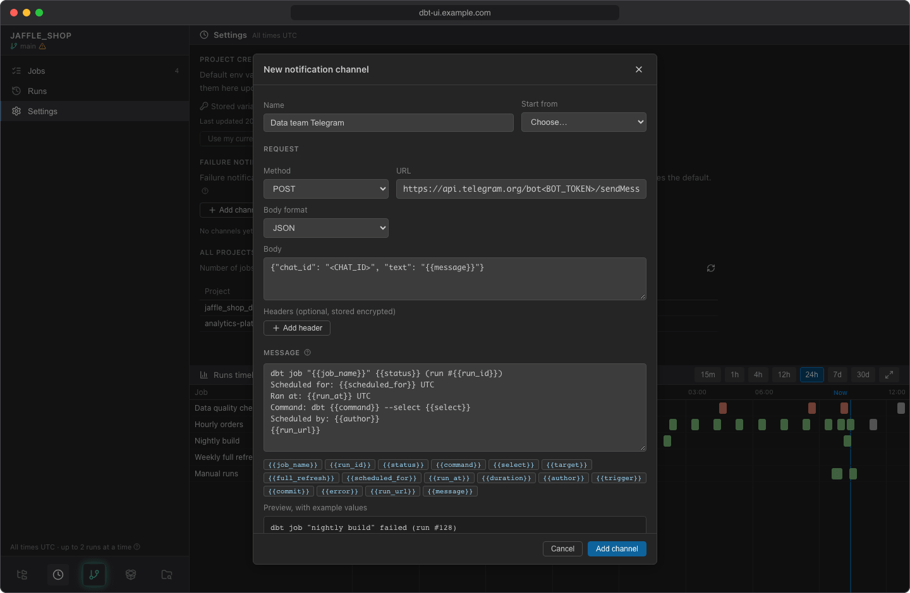

# Failure notifications

The scheduler can tell you when a job run fails by sending a message to a **notification channel**: a simple GET or POST request to the Telegram bot API or any HTTP(S) webhook. Channels belong to the dbt project and are managed in **Settings** of the scheduler, under **Failure notifications**.

## What is reported

A notification is sent when a **job run fails**: dbt reported an error, the run hit its timeout, dbt ran out of memory, or the run couldn't start. Each failed run is reported once, after it finishes.

These are not reported:

- Runs that are cancelled, skipped, or interrupted by a backend restart.
- Manual runs from the editor.
- Anything, if the project has no channels.

The message goes to the job's own channel if it has one, otherwise to the project's default channel.

## Add a channel

1. In the scheduler, open **Settings** and click **Add channel** under **Failure notifications**.
2. Enter a **Name**, e.g. *team telegram*.
3. Under **Start from**, pick a preset to fill in the request: **Telegram bot**, **JSON webhook (POST)** or **GET request**.
4. Complete the request:
    - **Method**: POST or GET.
    - **URL**: must start with `http://` or `https://`. It may contain placeholders.
    - **Body format** (POST only): JSON or Plain text.
    - **Body** (POST only): the request body, usually with `{{message}}` in it.
    - **Headers** (optional): e.g. an `Authorization` header. Click **Add header** for each one.
5. Adjust the **Message** if you like, and check the **Preview, with example values** below it.
6. Click **Add channel**.

The first channel you add becomes the project's default.



!!! example "Telegram"
    Create a bot with Telegram's BotFather to get its token, and find the chat ID of the chat or group the bot should write to. Choose the **Telegram bot** preset, then replace `<BOT_TOKEN>` in the URL and `<CHAT_ID>` in the body:

    - URL: `https://api.telegram.org/bot<BOT_TOKEN>/sendMessage`
    - Body: `{"chat_id": "<CHAT_ID>", "text": "{{message}}"}`

!!! example "Webhook"
    The **JSON webhook (POST)** preset sends `{"text": "{{message}}"}` to the URL you enter. Change the body to the format your endpoint expects. For a service that takes the message in the URL, use the **GET request** preset: `https://example.com/notify?text={{message}}`.

## Messages and placeholders

The **Message** is a template: write `{{placeholder}}` anywhere in it, or click a placeholder button below the message to insert it. Placeholders work in the URL and body too, and the rendered message is available there as `{{message}}`.

The default message is:

```text
dbt job "{{job_name}}" {{status}} (run #{{run_id}})
Scheduled for: {{scheduled_for}} UTC
Ran at: {{run_at}} UTC
Command: dbt {{command}} --select {{select}}
Scheduled by: {{author}}
{{run_url}}
```

| Placeholder | Value |
|---|---|
| `{{job_name}}` | Job name |
| `{{run_id}}` | Run number |
| `{{status}}` | Run status (`failed`) |
| `{{command}}` | dbt command (`build`, `run`, `test`, `seed`) |
| `{{select}}` | Selector, empty for the whole project |
| `{{target}}` | Target, empty for the profile default |
| `{{full_refresh}}` | Full refresh: `true` or `false` |
| `{{scheduled_for}}` | Time the run was scheduled for (UTC) |
| `{{run_at}}` | Time the run actually started (UTC) |
| `{{duration}}` | How long the run took |
| `{{author}}` | Who scheduled the run (the job's creator), or started it with Run now or a rerun |
| `{{trigger}}` | What started the run (schedule, catch-up, run now, rerun) |
| `{{commit}}` | Commit the run used (short SHA) |
| `{{error}}` | Error message (up to 1000 characters) |
| `{{run_url}}` | Link that opens the run in dbt UI |
| `{{message}}` | The rendered message template (URL and body only) |

Values are URL-encoded in the URL and JSON-escaped in a JSON body, so `"text": "{{message}}"` stays valid JSON whatever the message holds. In a plain-text body they are inserted as they are. A channel with an unknown placeholder can't be saved.

!!! note "`{{run_url}}` needs the dbt UI address"
    The link is built from `DBT_UI__FRONTEND_URL`. If your administrator hasn't set it, `{{run_url}}` is empty. See [Install with Docker](../getting-started/install.md).

## Default channel and per-job channels

- The project's **default** channel is marked *default* in the list. To make another channel the default, click its star (**Make default**).
- To send a job's failures somewhere else, open the job and choose the channel under **Failure notifications** > **Send to**. *Default channel* sends to whichever channel is the default at the time.
- Deleting a channel sends its jobs' failures to the default channel instead. If you delete the default channel, the oldest remaining channel becomes the default.

## Test a channel

Click the paper plane icon (**Send a test notification**) next to a channel. It sends a notification about the project's latest failed job run, or with example values if there is none, and tells you which: *Test sent to team telegram (about run #128)*. With example values, `{{run_url}}` links to dbt UI itself (`DBT_UI__FRONTEND_URL`), as there is no run to open. If the endpoint refuses the request, you see its response, e.g. *The endpoint did not accept it: HTTP 400: …*.

## See whether a notification was sent

The page of a failed run shows **Failure notification** with the channel and the time it was sent, or *not sent* with the endpoint's error. A line about it is also added at the end of the run's log.

The endpoint must answer within 10 seconds. A failed attempt is not retried.

## Edit a channel

Click the pencil next to a channel. The URL and header values are stored encrypted and are never shown again: the list only shows the URL's host and the header names.

- Leave **URL** empty to keep the stored one, or enter the full URL to change it.
- Tick **Replace stored headers** to replace all stored headers with the ones you enter; leave it unticked to keep them.
