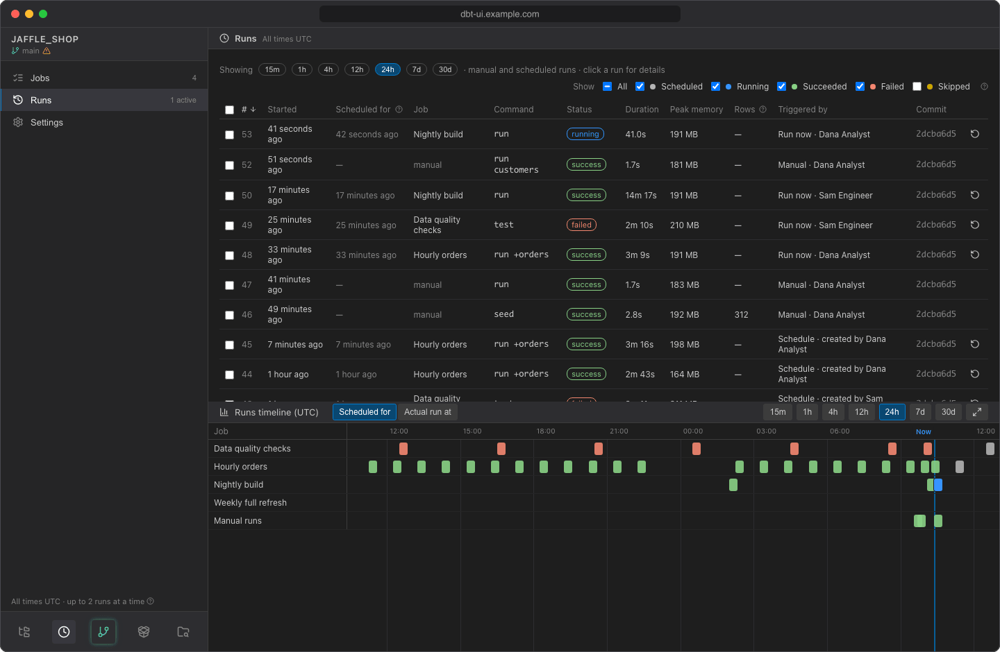
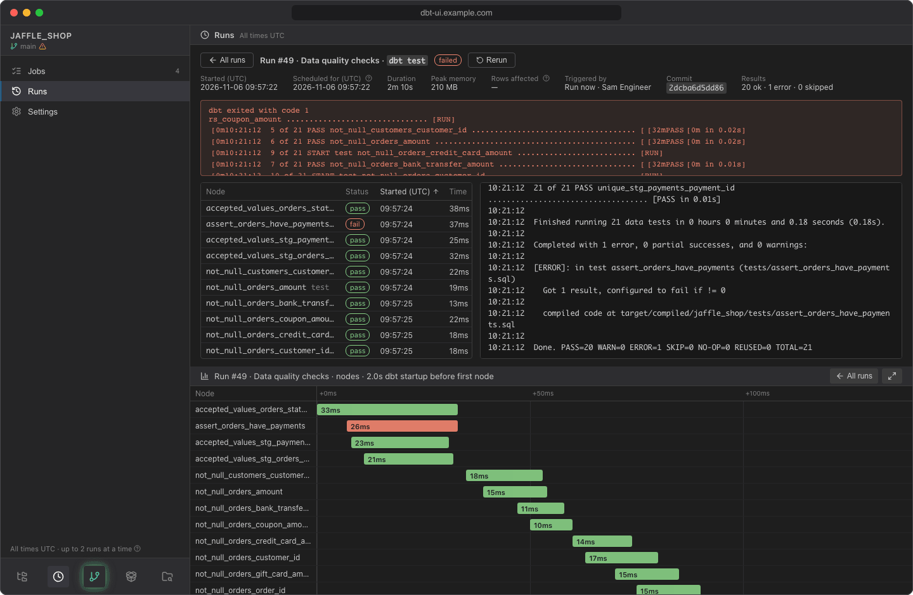
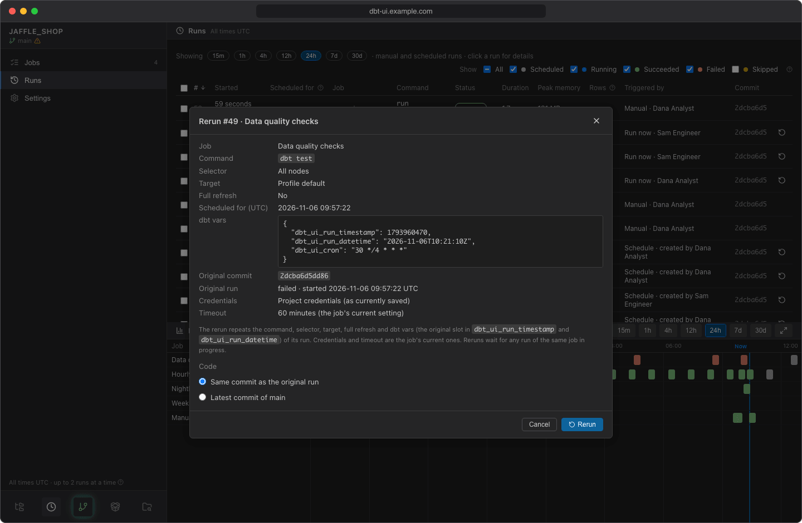

# Runs

**Runs** lists every run of the project: scheduled job runs, catch-up runs, reruns, **Run now**, and manual runs started from the editor. Open it from the scheduler sidebar. Click a run's row to open it.

## Choose what to list

**Time range.** The buttons after *Showing* choose the period: **15m**, **1h**, **4h**, **12h**, **24h** (default), **7d** or **30d**. A run is listed when it was queued or finished in that period, or hasn't finished yet. The [timeline](timeline.md) below always shows the same period.

**Status.** The checkboxes after *Show* choose which statuses are listed; **All** ticks or clears them all. The timeline follows the same filters.

| Filter | Statuses | Shown by default |
|---|---|---|
| **Scheduled** | `scheduled`: each enabled job's next run, not started yet | yes |
| **Running** | `queued` and `running` | yes |
| **Succeeded** | `success` | yes |
| **Failed** | `failed`, `cancelled` and `interrupted` | yes |
| **Skipped** | `skipped`: slots a job didn't run for, and runs you skipped | no |

dbt UI remembers your time range and filters in this browser. At most 1000 runs are listed; choose a shorter period if you need older ones in between.

!!! note "Run history is kept for 30 days"
    Finished runs and their logs are deleted after 30 days by default. Your administrator can change this with `DBT_UI__SCHEDULER_RETENTION_DAYS` (see the [configuration reference](../admin/configuration.md)).

## The runs table

| Column | What it shows |
|---|---|
| **#** | The run number. |
| **Started** | When the run started (or was queued, if it is still waiting). Empty for scheduled runs. |
| **Scheduled for** | The time the run is for: its cron slot. Catch-up runs and reruns keep the original time; **Run now** uses the time it was started; manual runs from the editor have none. This is the time passed to dbt as [dbt vars](catch-up.md#dbt-vars). |
| **Job** | The job name, or *manual* for runs started from the editor. |
| **Command** | The dbt command and selector. |
| **Status** | One of the statuses below. For skipped runs, hover the status to see why the run was skipped. |
| **Duration** | How long dbt ran. Runs still going count up. |
| **Peak memory** | The most memory the dbt process used. See [Sizing memory and concurrency](../admin/sizing.md). |
| **Rows** | Rows affected, as reported by dbt (see [Rows affected](#rows-affected)). |
| **Triggered by** | What started the run: *Schedule*, *Catch-up*, *Run now*, *Rerun of #…* or *Manual*, with the person's name. |
| **Commit** | The commit the run used. |

Times are shown relative to now (*5 minutes ago*, *yesterday*, *in 2 hours*, *tomorrow*); hover one for the exact UTC time. Click any column header to sort by it; click again to reverse the order.

### Statuses

| Status | Meaning |
|---|---|
| `scheduled` | The job's next run. It starts at the time in **Scheduled for**. |
| `queued` | Waiting: for the job's previous run to finish, or for a free slot when the server is already running as many dbt runs as it allows. |
| `running` | dbt is running. |
| `success` | dbt finished without errors. |
| `failed` | dbt reported an error, the run hit the job's timeout, dbt was killed because the server ran out of memory, or the run couldn't start (e.g. fetching the code failed). The error is shown on the run's page. |
| `cancelled` | You clicked **Cancel** on the run's page. |
| `interrupted` | The backend was stopped or restarted while the run was in progress. |
| `skipped` | The run didn't run for its slot: the job was paused, the slot was missed while dbt UI was down and the job doesn't catch it up, the previous run was still going, or someone skipped it. |

## Open a run

Click a run's row to open it. The page shows:

- **Started (UTC)**, **Scheduled for (UTC)**, **Duration**, **Peak memory**, **Rows affected**, **Triggered by** and **Commit**.
- **Results**: how many nodes succeeded, failed and were skipped, e.g. *12 ok · 1 error · 0 skipped*.
- **Failure notification**: for failed job runs, which channel was notified and when, or the endpoint's error if sending failed. See [Failure notifications](notifications.md).
- The error message, if the run didn't succeed.
- A table of **node results**: each model, test, seed or snapshot with its status, start time, execution time, rows affected and the dbt thread. Hover a node for dbt's message. The table is sortable.
- The **log** of the run. While the run is going, it updates live and follows the end of the output; scroll up to stop following.

The [timeline](timeline.md) in the bottom panel switches to the nodes of this run. Click **All runs** to go back to the list.

### Rows affected

Rows affected is taken from what dbt-core reports for each node in its run results. Whether it is available depends on the database adapter: some report it only for certain operations (DuckDB, for example, only for seeds), others not at all. It is shown as — when not reported.

## Cancel a run

On the page of a queued or running run, click **Cancel**. dbt is asked to stop and to cancel the queries it is running in your warehouse; if it doesn't stop within about 30 seconds, it is killed. The run is recorded as `cancelled`. A queued run is cancelled before it starts.

## Rerun runs

You can rerun runs of existing jobs, including failed and skipped ones. Manual runs from the editor, runs of deleted jobs and scheduled runs can't be rerun.

1. Click the rerun icon (**Rerun for this slot**) at the end of a run's row, or **Rerun** on a run's page. To rerun several, tick their checkboxes and click **Rerun** in the bar above the table.
2. The confirmation lists what each rerun repeats: the command line, selector, target, full refresh, the slot it is for, the dbt vars and the original commit. For a single rerun it also shows the job's current timeout, in minutes.
3. Under **Code**, choose **Same commit as the original run** (default) or the job's current code source (the latest commit of the default branch, or its pinned commit).
4. Click **Rerun**.

What to expect:

- A rerun repeats the original run's command, selector, target, full refresh and [dbt vars](catch-up.md#dbt-vars), so dbt processes the original slot again.
- It uses the job's **current** credentials and timeout.
- Reruns wait for any run of the same job in progress. Several reruns run in slot order, one after another per job.
- A single rerun opens straight away; several stay in the list. Each is labelled *Rerun of #…* in **Triggered by**.

!!! tip "Backfill skipped slots"
    Tick **Skipped** in the filters, select the skipped runs (for example the slots while a job was paused) and rerun them. Each runs for its own slot, oldest first.

## Skip runs

**Skip this run** records a run that hasn't finished as `skipped`. Its time is not caught up again, and you can still rerun it later.

- A **scheduled** run is cancelled: the job skips that time, and its following scheduled time becomes its next run.
- A **queued** run won't start.
- A **running** run is stopped at once: dbt is killed without waiting for it to cancel its queries, so queued runs can start. Work it already did in your warehouse stays as it is.

To skip one run, click **Skip this run** on its page. To skip several, tick their checkboxes and click **Skip … runs** in the bar above the table. Finished runs can't be skipped. You are asked to confirm, and skipped runs disappear from the list unless **Skipped** is ticked.

!!! note "Cancel or skip?"
    Both stop a run. **Cancel** gives dbt time to cancel its queries and records the run as `cancelled`. **Skip this run** kills dbt immediately and records it as `skipped`. Neither is caught up again, and neither sends a failure notification.

## Select runs

Tick the checkbox of a row to select it; the checkbox in the header selects all runs listed for the period. The bar above the table shows how many are selected, with **Rerun**, **Skip** and **Clear selection**. A button is disabled when it doesn't apply to all of the selected runs; hover it to see why.
