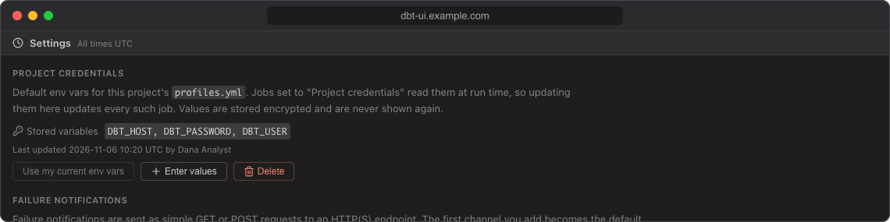
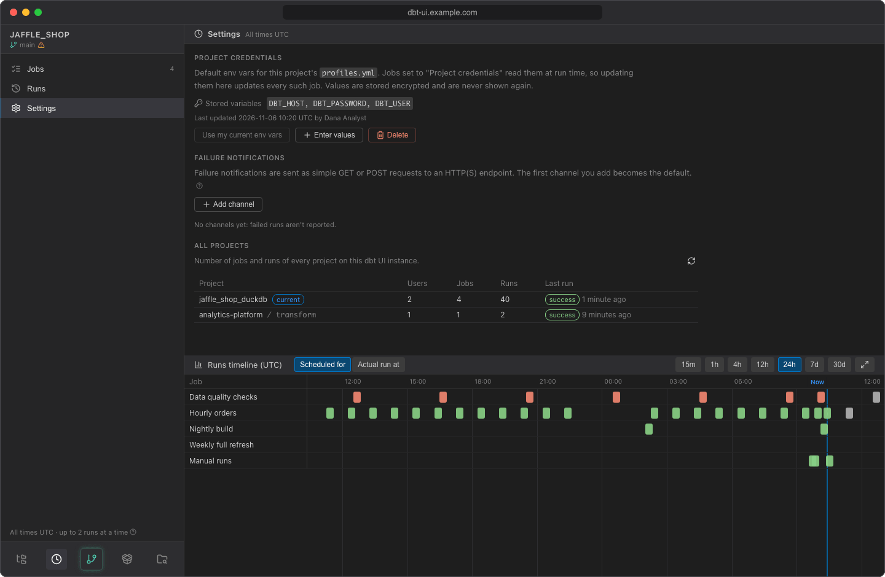

# Settings

Open **Settings** in the scheduler sidebar. It has three sections: **Project credentials**, **Failure notifications** and **All projects**. Project credentials and notification channels belong to the dbt project you have open and are shared by everyone who opens it.

## Project credentials

Project credentials are the default env vars for this project's `profiles.yml`. Jobs set to **Project credentials** read them when each run starts, so updating them here updates every such job. Use them for production jobs; see [Credentials](credentials.md) for when to use which.

The section shows the **Stored variables** (names only) and when and by whom they were last updated. Values are stored encrypted and are never shown again.

To set them, either:

- Click **Use my current env vars** to copy the env vars you have set in dbt UI for this project (see [Env vars](../using/env-vars.md)). Hover the button to see which variables it copies.
- Or click **Enter values**, enter a name and a value for each variable (click **Enter values** again for another row), and click **Save project credentials**. This replaces **all** stored project variables with the ones you entered, so enter every variable the jobs need. Names must start with a letter or underscore and contain only letters, digits and underscores.

To remove them, click **Delete** and confirm. This is refused while jobs use project credentials: switch those jobs to personal credentials or delete them first.

## Failure notifications

Add the channels that failed job runs are reported to, choose the default one, and test them. See [Failure notifications](notifications.md).

## All projects

**All projects** lists every dbt project on this dbt UI server that has scheduler jobs or runs, so you can see what is scheduled outside the project you have open. Your current project comes first, marked *current*; the others follow alphabetically. Click the refresh button to update the numbers.

| Column | What it shows |
|---|---|
| **Project** | The repository name and, for a dbt project in a subdirectory, the subdirectory (e.g. `analytics / dbt`). Hover it to see the repository's upstream git URL. |
| **Users** | How many people have a workspace of the project's git repository on this server, i.e. have opened it in dbt UI. It is counted per repository: dbt projects in different subdirectories of the same repository show the same number. |
| **Jobs** | Number of jobs. |
| **Runs** | Number of runs in the history, including manual and skipped runs (not counting the jobs' next scheduled runs). |
| **Last run** | Status and time of the latest run that ran or is running (skipped runs aren't counted). The time is relative, e.g. *3 hours ago*; hover it for the exact UTC time. |

The table is read-only. To manage another project's jobs, open that project.

!!! note
    Runs older than the retention period (30 days by default) are deleted, so **Runs** counts only the history that is kept. A project whose jobs were all deleted and whose runs have expired no longer appears.
