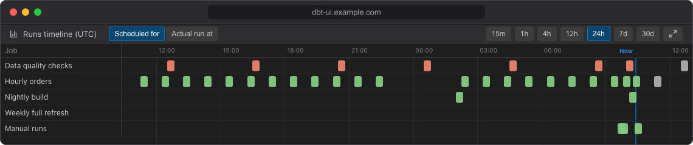
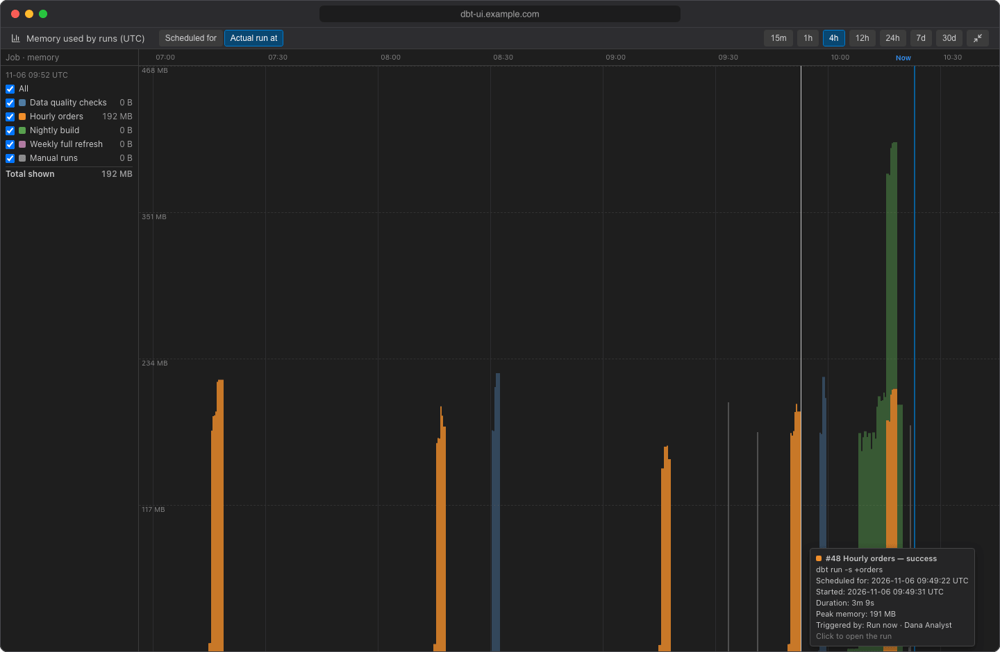

# Timeline

While the scheduler is open, the bottom panel shows the project's runs over time. It has two views, switched with the buttons in its header:

- **Scheduled for**: a Gantt chart with each run at the time it was scheduled for, so gaps in a schedule stand out.
- **Actual run at**: the memory runs used over the time they actually ran, stacked per job, which is the load the scheduler puts on the server.

Both use a UTC time axis. The latest part of the axis, about a tenth of the width, is kept for the near future, so the **Now** line sits near the right edge and the jobs' next runs are visible.

The timeline shows the runs of the [runs list](runs.md): the same time range and the same status filters. Changing one changes the other.

## Scheduled for

The chart has one row per job, plus a **Manual runs** row for runs started from the editor. Each run is a bar, coloured by status like in the runs list:

- A bar starts at the run's slot (the time it was scheduled for) and is as long as the run took, labelled with its number and duration, e.g. `#128 4m 12s`.
- Catch-up runs and reruns ran later than their slot: their label adds when they actually ran, e.g. `· ran at 07:45`.
- A job's next run is drawn after the **Now** line, labelled `#… next`, as long as the job's latest finished run took.
- Skipped runs are small markers at their slot. They only appear when **Skipped** is ticked in the runs filters.
- Manual runs have no slot, so they are placed at the time they ran.

Hover a bar for the run's details: command, start and scheduled times, duration, peak memory, rows affected, who triggered it and the commit. Click a bar to open the run.

## Actual run at

This view is a stacked area chart of the memory used by dbt runs over the time they ran, one coloured area per job (plus **Manual runs**). The top edge of the stack is the total memory used by the runs shown at each moment. Use it to see when runs pile up and how close you get to the server's memory; see [Sizing memory and concurrency](../admin/sizing.md).

The legend on the left lists the jobs:

- Untick a job to hide it, or untick **All** to hide every job. dbt UI remembers hidden jobs in this browser.
- Each job shows its peak in the range, and **Total shown** the peak of all visible jobs. While you hover the chart, the legend shows the values at that moment instead, with the time at the top.

Hover an area to see the runs behind it at that moment. Click to open the run; if several runs are there, the click keeps the tooltip open so you can pick one (Esc or click outside to close it).

## For one run

When you open a run, the timeline shows one row per node of that run: each model, test, seed or snapshot as a bar from when it started to when it finished, so you can see which nodes take longest and how dbt's threads were used. The time axis counts from the first node (`+1.5s`, `+2m 0s`, …), and the header shows how long dbt took to start before the first node. Hover a bar for the node's status, time, rows affected, thread and message.

Click **All runs** to go back to all runs.

## Zoom, scroll and expand

- Choose the time range with the buttons in the header (**15m** to **30d**), or **scroll over the chart**: scrolling up zooms in to a shorter range, scrolling down zooms out.
- **Shift + scroll** moves the rows up and down when there are more than fit.
- Within the chosen range, the axis zooms to the runs that are there, but never to less than 30 minutes (or the whole range, for **15m**).
- The chart always fits the panel width; it only scrolls vertically.
- Click the expand button at the right of the header to show the timeline in the full window. Press **Esc** or click the button again to collapse it.
