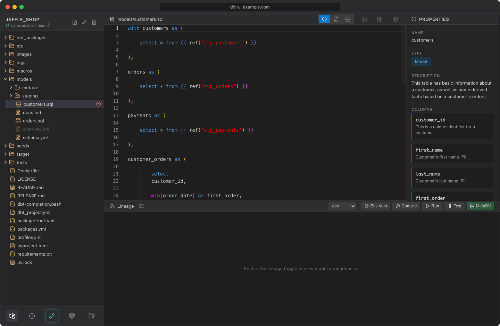
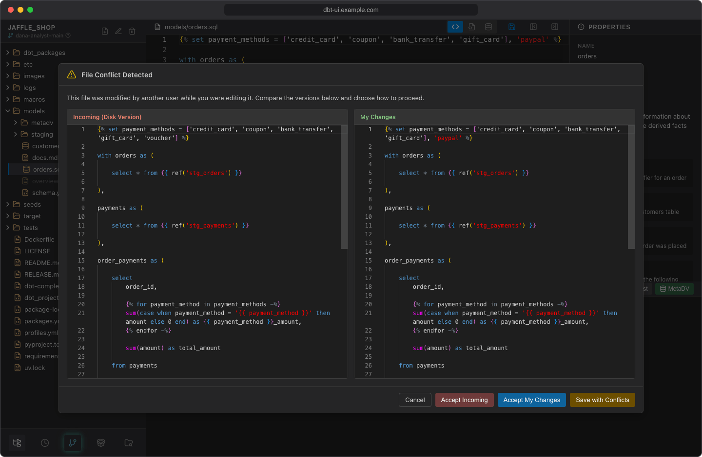

# Editor

The editor in the middle of the screen opens the file you select in the [project browser](project-browser.md) or in the [lineage graph](lineage.md). It's based on Monaco, the editor of VS Code, with syntax highlighting for SQL, YAML, JSON, Python and Markdown.

## Views by file type

Some files have more than one view. Switch between them with the buttons in the editor header.

| File | Views |
| --- | --- |
| SQL model (a `.sql` file in a `models` folder) | **Source view** (editable), **Compiled SQL** (read-only), **Preview data (dbt show)** |
| CSV file (for example a seed) | **Table view** (opens first), **Text view** (editable) |
| JSON file | **Text view (editable)**, **Formatted view (read-only)** |
| Anything else (YAML, macros, tests, Markdown, ...) | Text only |

**Compiled SQL** shows the SQL that dbt generated for the model the last time it was compiled. If the model hasn't been compiled yet, it shows a comment such as `-- Compiled SQL file not found. Please compile the project first.` Compile the model from the [lineage panel](running-dbt.md) and the view updates.

**Preview data** runs a query against your warehouse; see [Show data](show-data.md).

Binary files show "Cannot display binary file" and can't be edited.

## Edit and save

1. Edit the file in a text view (**Source view**, **Text view**).
2. Click **Save** in the editor header.

The **Save** button is highlighted while you have unsaved changes. It's only available in editable views: in a read-only view it shows "Save not available in this view". There's no keyboard shortcut for saving.

Saved files are written to your workspace on the server right away. Other users don't see them until you [commit and push](git.md).

### Unsaved changes

- **Running dbt:** if you click **Compile**, **Run** or **Test** with unsaved changes, dbt UI asks whether to save first: **Save**, **Don't Save** (run against the file as it is on disk) or **Cancel**.
- **Opening another file:** if you select another file or folder in the project browser, click a node in the lineage graph, or create a new file, dbt UI asks the same question first: **Save**, **Don't Save** (discard your changes) or **Cancel** (stay on the current file).
- **Switching projects:** the confirmation warns that unsaved changes will be lost.

## Conflicts when saving

When you save, dbt UI checks whether the file on disk changed since you opened it, for example after a pull or when the same file is open in a second browser tab.

- If the changes don't overlap, dbt UI merges them with yours, saves the result and shows it in the editor.
- If they overlap, the **File Conflict Detected** dialog shows both versions side by side: **Incoming (Disk Version)** and **My Changes**.

Choose how to continue:

| Button | Result |
| --- | --- |
| **Accept Incoming** | Discards your changes and loads the version on disk |
| **Accept My Changes** | Saves your version, overwriting the version on disk |
| **Save with Conflicts** | Puts the merged text into the editor with conflict markers (`<<<<<<< YOUR CHANGES`, `=======`, `>>>>>>> DISK VERSION`). Resolve them, then click **Save** |
| **Cancel** | Closes the dialog; your changes stay in the editor, unsaved |

## Properties panel

The **Properties** panel on the right shows what dbt knows about the selected file, read from the project's `manifest.json`:

- **Name** and **Type** (model, seed, macro, source)
- **Description**
- **Columns**, with their descriptions
- other details when present, such as database, schema, alias, materialization, tags, meta, tests and dependencies

The manifest is written whenever dbt compiles or runs the project, and the panel reloads after a compile. If there's no manifest yet, or the file isn't in it, the panel shows only the name and a type guessed from the file path, with the hint "Click Compile in the lineage panel header to generate metadata."

To hide the panel, click **Hide properties** in the editor header; **Show properties** brings it back. You can also drag the panel's edge to resize it.
