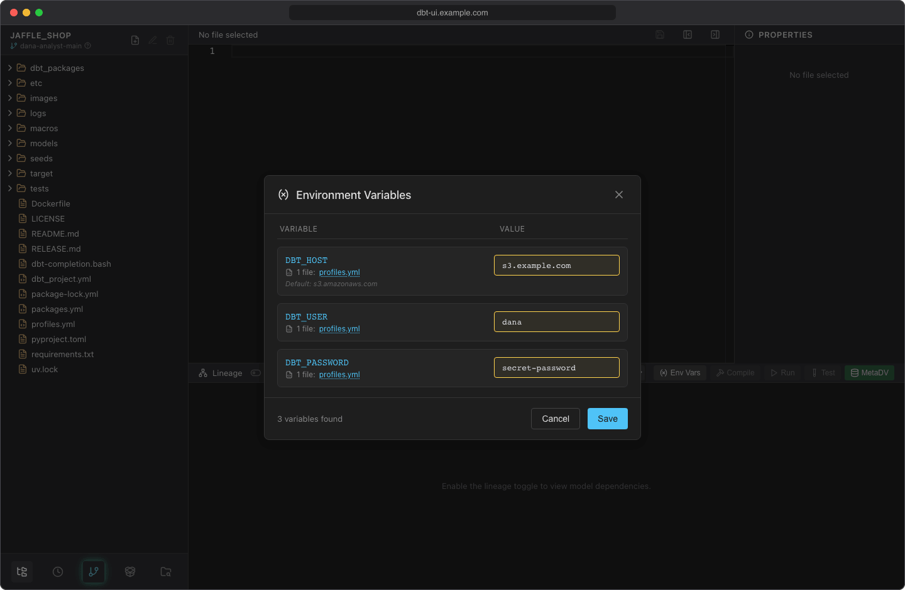

# Env vars

dbt projects often read secrets and settings from environment variables with `env_var()`, most commonly the warehouse credentials in `profiles.yml`:

```yaml title="profiles.yml"
analytics:
  target: dev
  outputs:
    dev:
      type: postgres
      host: "{{ env_var('DBT_HOST') }}"
      user: "{{ env_var('DBT_USER') }}"
      password: "{{ env_var('DBT_PASSWORD') }}"
      schema: "{{ env_var('DBT_SCHEMA', 'analytics_dev') }}"
      ...
```

dbt UI finds these variables in your project and lets each user set their own values, so everyone connects with their own credentials without putting them in git.

## Set values

1. Click **Env Vars** in the lineage panel header. The button is shown once the project has a [virtual environment](../getting-started/first-project.md#3-create-the-virtual-environment), and is disabled while a dbt command is running.
2. dbt UI scans the project and lists every variable it found, with the files that use it. Click a file name to open that file.
3. Enter a value for each variable you need. A variable with a default in the project shows it under its name ("Default: …") and in the empty field ("Empty: uses the default (…)").
4. Click **Save**.



The footer shows how many variables were found. **Save** is enabled once you've changed a value.

## Which `env_var()` calls are found

dbt UI scans the `.sql`, `.yml` and `.yaml` files of your project, including `profiles.yml`. It skips hidden folders and the `target`, `dbt_packages`, `logs`, `venv`, `__pycache__`, `node_modules` and `py_cache` folders.

A call is found wherever `env_var(` appears with the variable name in quotes: in `{{ }}`, `{{- -}}` and `` blocks, inside expressions and other calls, with single or double quotes, and with the quotes escaped inside a double-quoted YAML string. For example:

| In your file | Found |
| --- | --- |
| `{{ env_var('DBT_USER') }}` | :white_check_mark: |
| `{{env_var("DBT_USER")}}` | :white_check_mark: |
| `{{ env_var('DBT_SCHEMA', 'analytics_dev') }}` | :white_check_mark: (with the default) |
| `{{ env_var('DBT_THREADS', '4') \| int }}` | :white_check_mark: (with the default) |
| `{{- env_var('DBT_USER') -}}` | :white_check_mark: |
| `{{ 'raw_' ~ env_var('DBT_ENV') }}` | :white_check_mark: |
| `{{ var('schema', env_var('DBT_SCHEMA')) }}` | :white_check_mark: |
| `` | :white_check_mark: |
| `"{{ env_var(\"DBT_USER\") }}"` (in YAML) | :white_check_mark: |
| `{{ env_var(name_var) }}` (name in a variable) | :x: |

A call whose name isn't a quoted string still works when dbt runs, as long as the variable has a value. It just doesn't appear in the dialog, so you can't set it there.

!!! note "Default values"
    A default in `env_var('NAME', 'default')` is shown in the dialog, but the field isn't filled with it. Leave the field empty and the variable stays unset, so dbt applies the default as usual (or the value set on the server, see below). Enter a value only to override the default.

## Where values are stored

Values are stored **in your browser**, in a cookie for this project and your workspace. They aren't written to the server's disk or to git, and other users can't see them.

- The cookie lasts one year.
- Each browser has its own values. In a different browser, or after clearing cookies, set them again.
- Saving replaces all stored values for the project with what's in the dialog. Variables you leave empty aren't stored.

!!! warning
    The cookie isn't encrypted. Anyone with access to your browser profile can read the values. Use credentials meant for one person, and don't set values on a shared computer.

## How values are used

dbt UI doesn't change your files. When it starts dbt for you, it passes the stored values to the dbt process as environment variables, and dbt's `env_var()` reads them as usual. A value you set takes precedence over a variable with the same name in the backend's environment. dbt UI's own settings (all `DBT_UI__*` variables) are never passed to dbt, so `env_var('DBT_UI__…')` doesn't return them.

Your values are applied to:

- **Compile**, **Run**, **Test** and **Seed** from the [lineage panel](running-dbt.md)
- listing the models a command affects (`dbt ls`), for the spinners in the file tree
- [Show data](show-data.md)
- `dbt deps` when you [create the virtual environment](../getting-started/first-project.md#3-create-the-virtual-environment)
- fetching source columns in [MetaDV](metadv.md)

Because the values travel with each request, changes apply from the next command you start. There's nothing to restart.

## Scheduled jobs

A [scheduled job](../scheduler/index.md) runs without your browser, so it can't read your cookie. Instead, a job with personal credentials stores an encrypted **snapshot** of your env vars when you create it. Saving a change to the job, or checking **Replace the stored snapshot with my current env vars**, replaces the snapshot with your current values. Other changes in the Env Vars dialog don't reach the job.

Jobs can also use project credentials shared by the whole team. See [Credentials](../scheduler/credentials.md) for both options.
