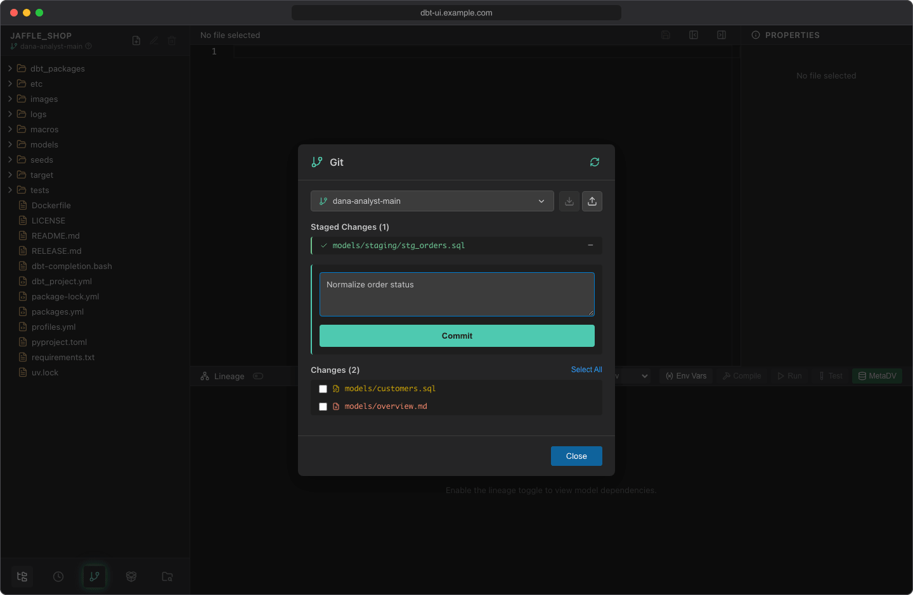

# Git

Every change you make in dbt UI happens on your own branch, in your own [workspace](../getting-started/first-project.md#your-personal-workspace). The Git dialog is where you commit those changes, share them by pushing, get other people's changes by pulling, and work with branches.

Open it with the **Git** button at the bottom of the sidebar. The button glows when you have uncommitted changes.

## See what changed

The dialog lists your uncommitted work in two sections:

- **Staged Changes**: files that go into the next commit.
- **Changes**: everything else that differs from your last commit, marked by type: modified, new (untracked) or deleted.

The [file tree](project-browser.md) marks the same files: modified and new files with a warning-circle icon, deleted files struck through.

The dialog lists files but doesn't show diffs.

Click **Refresh** (the circular arrow in the dialog header) to reload the lists, for example after running dbt. When there's nothing to commit, the dialog shows "Working tree clean".

## Stage and commit

1. Under **Changes**, check the files to commit, or click **Select All**. **Deselect** clears the selection.
2. Click **Stage Selected (*n*)**. The files move to **Staged Changes**.
3. Enter a **Commit message**.
4. Click **Commit**.

The dialog confirms with "Committed: *hash*". The commit is authored with the name and email you set in dbt UI (see [Open your first project](../getting-started/first-project.md#1-set-your-git-identity)).

To take a file out of the next commit, click **−** ("Unstage") next to it under **Staged Changes**.

!!! tip
    If `.dbt-ui-venv/`, `target/`, `dbt_packages/` or `logs/` show up under **Changes**, add them to your project's `.gitignore`.

## Push and pull

The two buttons next to the branch selector work with the `origin` remote:

| Button | What it does |
| --- | --- |
| **Push** (upload icon, "Push to origin") | Pushes the current branch to `origin` and sets it as the upstream. On the first push it creates the branch on the remote ("Push and create remote branch"). A badge shows how many commits you're ahead |
| **Pull** (download icon, "Pull from origin") | Runs `git pull` for the current branch. A badge shows how many commits you're behind. Disabled until the branch has a remote tracking branch ("No remote tracking branch") |

Your own branch (for example `jane-doe-main`) doesn't exist on the remote until you push it, so **Pull** stays disabled until your first push.

The ahead and behind counts compare with the state of the remote that dbt UI last fetched. It fetches when you open the project and when you create a branch, so commits other people pushed since then aren't counted yet.

To get your changes into the main branch, push your branch and open a pull or merge request on your git host as usual.

## Switch and create branches

Click the branch selector (it shows the current branch) to see the local branches.

**Switch** by clicking a branch. Some branches are greyed out; hover them to see why:

| Reason | Meaning |
| --- | --- |
| Default branch | The repository's default branch (`main` or `master`). Work happens on other branches and reaches it through your git host |
| Checked out in another worktree | Another user's workspace has this branch checked out |
| Another user's default branch | Another user's personal `*-main` branch |

**Create a branch:**

1. Click **New Branch** at the bottom of the list.
2. Enter a name and click **Create** (or press ++enter++).

dbt UI fetches the latest default branch from `origin` and starts the new branch from it (from the local default branch if the remote one isn't available), then switches to it. The name is converted to lowercase, and characters other than letters, digits, `.`, `_` and `-` become `-`: `Fix Orders` becomes `fix-orders`.

After switching or creating a branch, the file tree reloads. Uncommitted changes come along to the new branch when git allows it; otherwise switching fails with git's error message, and you need to commit your changes first.

## Delete a branch

1. In the branch list, click the trash icon (**Delete branch**) next to a branch. You can't delete the current branch, the default branch, your own `*-main` branch or a branch checked out in another workspace.
2. Confirm with **Delete branch**, or click **Cancel**.

!!! warning "Deleting also affects the remote"
    dbt UI deletes the branch locally and on `origin`. It's force-deleted, so commits that aren't merged into another branch are lost.

## Credentials for private remotes

For `https://` remotes, dbt UI asks for credentials when you push or pull, in the **Authentication Required** dialog:

- Enter your **Username** and **Password / Token** and click **Submit**. For GitHub, use a personal access token.
- With **Remember credentials** checked (the default), dbt UI saves them after a successful push, pull or clone.
- Next time, click **Use Saved Credentials (*username*)** instead of typing them again.

Saved credentials are stored in a cookie in your browser, one per repository, for 30 days by default. Administrators can change the duration with `DBT_UI__BACKEND_GIT_CREDS_COOKIE_MAX_AGE` (in seconds). The same saved credentials are used for cloning, pushing and pulling, and [scheduled jobs](../scheduler/credentials.md) can store a copy to pull the latest changes before they run.

For SSH remotes (`git@...`), dbt UI doesn't ask for credentials and relies on the SSH access configured for the backend.
