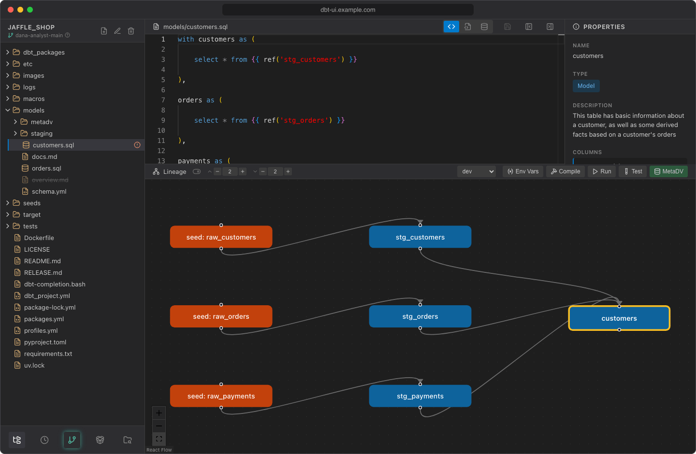

# Lineage graph

The lineage panel below the editor draws your models, seeds and sources as a graph, so you can see what a model depends on and what depends on it. Its header also holds the buttons to [run dbt](running-dbt.md).

## Turn it on

The graph is off when you open a project. Click the toggle next to **Lineage** ("Enable lineage") to show it. It stays on until you reload the page.

The graph is built from the project's `manifest.json`. If there's none yet, the panel shows "Compile dbt models to generate lineage data.": select a model and click **Compile**, leaving the selector empty to compile the whole project (see [Running dbt](running-dbt.md)). The graph reloads after each compile.

## Read the graph

Arrows point from a node to the nodes that use it: upstream nodes are on the left, downstream nodes on the right.

| Node | Color | Label |
| --- | --- | --- |
| Model | Blue | model name |
| Source | Green | `source: <source>_<table>` |
| Seed | Orange | `seed: <seed name>` |

The node of the selected file has a yellow border. Tests, macros and other resources aren't shown.

## Navigate

- **Focus on a model.** Select a model or seed file in the project browser, or click a model or seed node. The graph shows that node with its upstream and downstream neighbors and centers on it.
- **Open a file.** Clicking a node opens its file in the editor. A source node opens the YAML file that defines it; since that file isn't a node itself, the graph then switches to the overview.
- **Overview.** When the selected file isn't in the graph (for example a macro, or nothing is selected), the graph shows all models, seeds and sources and fits them into the panel.
- **Pan and zoom** with the mouse (drag the background, scroll to zoom) or with the zoom and fit buttons in the corner. Nodes can't be dragged.

## Depth

When the graph is on, two depth controls appear next to the toggle:

- **Upstream depth** (arrow up): how many levels of parents to show
- **Downstream depth** (arrow down): how many levels of children to show

Both default to **2** and range from 1 to 10. Use the **−** and **+** buttons or type a number.

## Node limit

To keep the browser responsive, the graph shows at most **200** nodes. When there are more:

- With a node in focus, the graph falls back to the node and its direct parents and children, and shows "Graph has *N* nodes (limit: 200). Reduce upstream/downstream depth values."
- In the overview, it shows the first 200 nodes.

Administrators can change the limit with `DBT_UI__FRONTEND_LINEAGE_MAX_NODES`. It's applied when the frontend image is built, so rebuild after changing it (see the [configuration reference](../admin/configuration.md)).

## Quick actions

The right side of the panel header has the actions for the selected file:

| Control | Use |
| --- | --- |
| Target dropdown ("Select dbt target") | The `profiles.yml` target the commands run against |
| **Env Vars** | Set [env var](env-vars.md) values |
| **Compile** | Compile the selected model |
| **Run** | Run the selected model, or seed the selected seed |
| **Test** | Test the selected model |
| **MetaDV** | Open [MetaDV](metadv.md) (only when the feature is on) |

The actions follow your selection, so clicking a node and then **Run** runs that node's model. See [Running dbt](running-dbt.md) for how commands run.
