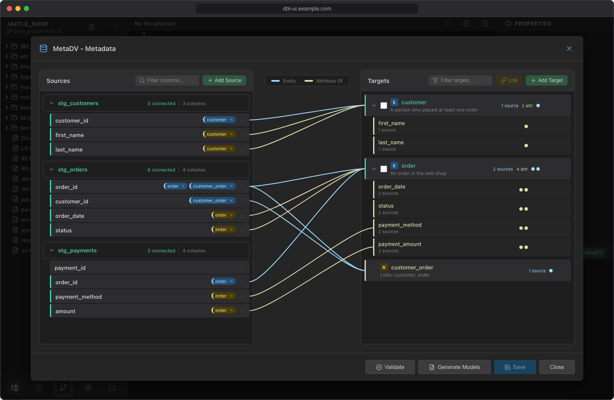

# MetaDV

MetaDV is a visual editor for Data Vault 2.0 metadata. You map the columns of your source models to business entities and their relations, and MetaDV generates the dbt models (stage, hub, link and satellite models) from that mapping. Generation is done by the [metadv](https://pypi.org/project/metadv/) Python package, which builds on a Data Vault dbt package.



## Requirements

The **MetaDV** button in the lineage panel header is enabled when the project's `packages.yml` (or `dependencies.yml`) lists a package that metadv supports:

| Package | Generates |
| --- | --- |
| `Datavault-UK/automate_dv` | Data Vault 2.0 models with automate_dv macros |
| `ScalefreeCOM/datavault4dbt` | Data Vault 2.0 models with datavault4dbt macros |
| `dimensional` | Dimension and fact models |

For example:

```yaml title="packages.yml"
packages:
  - package: Datavault-UK/automate_dv
    version: <version you use>
```

After adding the package, save the file and [recreate the virtual environment](../getting-started/first-project.md#3-create-the-virtual-environment) so `dbt deps` installs it. Hover the button while it's disabled for a hint naming the Data Vault packages.

You also need:

- **Built source models.** MetaDV reads the columns of a source by querying the model in your warehouse, so run your source (staging or raw) models first.
- **Your [env vars](env-vars.md)**, if `profiles.yml` uses `env_var()`. The query uses the target selected in the lineage panel.

## Open MetaDV

Click **MetaDV** in the lineage panel header. The first time, MetaDV creates `models/metadv/metadv.yml`, where it keeps your mapping.

The dialog has two lists:

- **Sources** on the left: the columns of your source models, grouped by model.
- **Targets** on the right: your entities and the relations between them, each with its attributes.

Lines between the lists show the connections, colored by type (see the legend): **Entity** or **Attribute Of**. Hover a source, target or attribute to highlight its connections. Both lists have a filter field.

## Add sources

1. Click **Add Source**.
2. Enter the **Model Name** of an existing dbt model, for example `raw_customers`.
3. Click **Add Source**. MetaDV queries one row of the model to read its column names.

Next to each source you can **Refresh columns from database** (after the model changed), **Edit source** (rename it; existing connections follow) and **Delete source**.

## Add targets

**Entity** (for example `customer`):

1. Click **Add Target**.
2. Enter the **Target Name** and, optionally, a **Description**.
3. Click **Add Target**.

**Relation** between entities:

1. Check **Select for linking** on two or more entities.
2. Click **Link (*n*)**.

With a single entity selected, **Link** offers a self-referencing relation (**Create Self-Link**), for hierarchies such as employee and manager.

Use **Edit target** and **Delete target** on a target to change or remove it.

## Map columns

Drag a source column onto a target. A **Connection Type** menu appears:

- **Entity (*name*)**: the column is the business key of that entity. On a relation, pick which of its entities the column identifies.
- **Attribute Of**: the column is descriptive data about the target. It's added to the target's attributes.

You can also drop a column directly on an existing attribute to connect it as that attribute.

On an attribute you can **Rename attribute**, **Delete attribute** and toggle **Enable multiactive key** (the key icon), which marks it as a multi-active key and leads to a multi-active satellite in the generated models.

To remove a connection, click the **×** on the tag next to the source column (**Remove connection**), or click the line and confirm **Delete**.

## Save, validate and generate

The header shows **Unsaved changes** while you have changes that aren't saved yet.

1. Click **Save** to write the mapping to `models/metadv/metadv.yml`.
2. Click **Validate** to check it. Validation works on the saved file, so save first. Results appear in the footer as error and warning counts; click them to see the details. For example, every relation needs sources for its entities, and every target should have a description.
3. Click **Generate Models**. With unsaved changes, MetaDV asks whether to save first; generating without saving uses the last saved file. Generation stops if validation finds errors.

The generated models are written to subfolders of `models/metadv`, for example `stage/`, `hub/`, `link/` and `sat/` for Data Vault packages, or `dim/` and `fact/` for `dimensional`. The footer reports how many models were generated, and the file tree refreshes when you close the dialog.

!!! warning "Generating replaces the folder"
    Before generating, MetaDV deletes everything in `models/metadv` except `metadv.yml`. Don't put your own files in that folder: they would be lost on the next generation. Commit before you generate if you want to compare the result in the [Git dialog](git.md).

If you close the dialog (**Close**, the × button, clicking outside it or ++esc++) with unsaved changes, MetaDV asks first: **Save** saves and closes, **Don't Save** closes and discards the changes, **Cancel** keeps the dialog open.

The generated files are ordinary dbt models: review them in the [editor](editor.md), [run them](running-dbt.md) and commit them like any other file.

## Turn MetaDV off

MetaDV is on by default. To hide it for everyone, set `DBT_UI__METADV_ENABLED=false` for dbt UI (see the [configuration reference](../admin/configuration.md)). The **MetaDV** button then disappears from the lineage panel.
