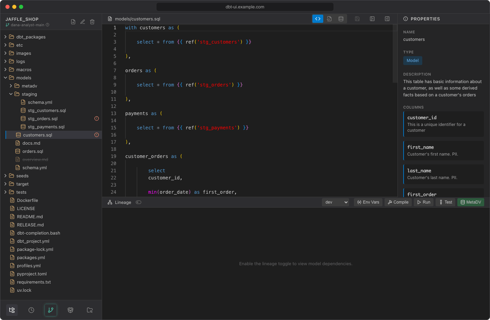

# Project browser

The sidebar on the left shows your dbt project as a file tree. Click a file to open it in the [editor](editor.md); the lineage graph and properties panel follow your selection. If the open file has unsaved changes, dbt UI first asks whether to save them (see [Unsaved changes](editor.md#unsaved-changes)).

## The file tree

The tree shows the files in your [personal workspace](../getting-started/first-project.md#your-personal-workspace), folders first, each level sorted by name. Folders load their contents when you expand them.

| What you see | Meaning |
| --- | --- |
| Icon by file type | Database icon for `.sql`, code icon for `.yml`/`.yaml`, table icon for `.csv`, braces for `.json`, scroll for `.log` |
| Warning-circle icon after a name | The file is modified or new (untracked) compared to your last commit |
| Spinner after a model | dbt is currently running, testing or compiling this model |
| ~~Struck-through name~~ | The file was deleted, but it still exists in your last commit and can be restored |

Hidden files and folders (names starting with `.`, such as `.dbt-ui-venv`), `__pycache__` and `node_modules` aren't shown. Folders such as `target` and `logs` are shown and refresh after each dbt command.

To hide the sidebar, click **Hide sidebar** in the editor header; **Show sidebar** brings it back.

## Branch indicator

Under the project name, the sidebar shows the branch you're on, normally your own branch such as `jane-doe-main`. Hover the question mark next to it to see where your workspace lives on the server: each user works in a separate git worktree, so your changes don't affect other users until you push them.

To switch or create branches, use the [Git dialog](git.md#switch-and-create-branches).

## Create, rename, move and delete files

The buttons next to the project name work on the selected file or folder.

### Create a file

1. Select the folder for the new file, or any file in that folder. With nothing selected, the file is created at the project root.
2. Click **Create file**. dbt UI creates an empty file named `untitled` (then `untitled2`, `untitled3`, ...) and opens it in the editor. If the open file has unsaved changes, dbt UI first asks whether to save them.
3. Click **Rename file** and give it a name with an extension, such as `stg_orders.sql`, so dbt picks it up and the editor highlights it. You can do this before or after you start typing.

Files without an extension, such as `untitled` or a `Makefile`, open in the editor as plain text.

### Rename or move

1. Select the file or folder and click **Rename file**.
2. The dialog shows the item's path relative to the project root. Change it and click **Rename**.

You can change the folder part of the path too: missing folders are created, so this also moves the item. Renaming fails if a file or folder with the new path already exists.

To move an item, you can also drag it onto a folder, or onto **Drop here to move to root** at the bottom of the tree.

### Delete and restore

1. Select the file or folder and click **Delete file**.
2. Confirm with **Delete**. Deleting a folder deletes everything in it.

A deleted file that was committed stays in the tree, struck through. To bring it back, select it and click **Restore file**: dbt UI restores the version from your last commit. Files that were never committed are gone for good.

## Sidebar buttons

The buttons at the bottom of the sidebar:

| Button | What it does |
| --- | --- |
| **Files and editor** | Shows the file tree, editor and lineage graph (the default view) |
| **Scheduler** | Opens the [scheduler](../scheduler/index.md). Disabled when the scheduler is off; hover it to see why |
| **Git** | Opens the [Git dialog](git.md). It glows when you have uncommitted changes |
| **Create virtual environment** | Creates or rebuilds the Python environment that runs dbt. It glows when the environment is missing (see [Open your first project](../getting-started/first-project.md#3-create-the-virtual-environment)) |
| **Select another project** | Goes back to the project screen |

A thin progress bar above the buttons shows while a dbt command is running.

## Switch to another project

1. Click **Select another project**.
2. Confirm with **Switch project**. If the editor has unsaved changes, the dialog warns that they will be lost.

You're back on the project screen, with your recent projects listed below the input. Your workspace stays on the server, including uncommitted changes, so you can return to it later.
