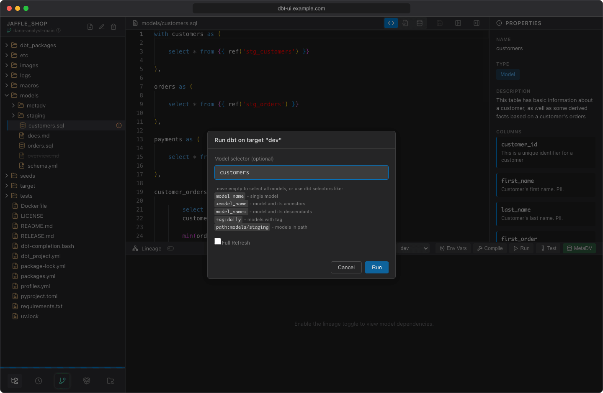
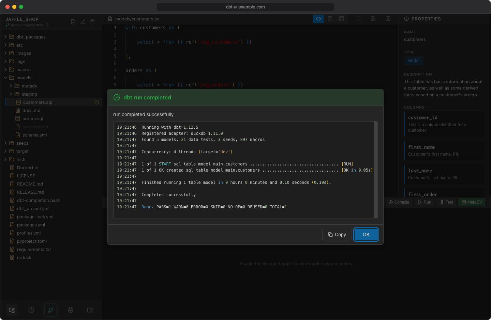

# Running dbt

Run, test, seed and compile from the [lineage panel](lineage.md) header. dbt runs on the server, in your [personal workspace](../getting-started/first-project.md#your-personal-workspace), with the project's virtual environment and your [env vars](env-vars.md).

## Before you start

- The project needs a [virtual environment](../getting-started/first-project.md#3-create-the-virtual-environment).
- dbt UI must find at least one target in the `profiles.yml` in the project folder. The target dropdown appears in the lineage panel header when it does.
- Set your [env vars](env-vars.md) if `profiles.yml` uses `env_var()`.

If any of these is missing, the buttons stay disabled.

## Run a command

1. Select a file in the project browser or a node in the lineage graph:
    - a SQL model (a `.sql` file in a `models` folder) for **Compile**, **Run** and **Test**,
    - a CSV file in a `seeds` folder for **Run**, which then seeds it.
2. Pick the target in the dropdown ("Select dbt target"). It starts at the default target of your profile.
3. Click **Compile**, **Run** or **Test**. If the editor has unsaved changes, dbt UI first asks whether to save them.
4. The dialog ("Run dbt on target "dev"") is pre-filled with the selected model or seed. Change the selector if you like:
    - leave it empty to select all models (or all seeds),
    - use dbt selector syntax, for example `+model_name` (with its ancestors), `model_name+` (with its descendants), `tag:daily` or `path:models/staging`.
5. For **Run** and seeds, check **Full Refresh** to add `--full-refresh`.
6. Click the action button (or press ++enter++). ++esc++ cancels.



dbt UI runs, for example:

```bash
dbt run --select <selector> --target <target> --project-dir <project> --profiles-dir <project>
```

The selector accepts letters, digits, spaces and `_ . : + @ * - / ,`. Other characters are rejected with "Invalid characters in selector."

## While it runs

The command runs in the background:

- the models it affects show a spinner in the file tree, and a progress bar appears at the bottom of the sidebar,
- the dbt buttons, **Env Vars** and **Create virtual environment** are disabled.

Only one command runs in your workspace at a time. Your other workspaces and other users aren't blocked; with the scheduler on, they share its concurrency limit (see below).

You can keep editing and browsing in the meantime.

## Results

When the command finishes, a dialog shows the result: "dbt run completed" or "dbt run failed", with dbt's output below. Click **Copy** to copy the output, and **OK** (or ++enter++ / ++esc++) to close it.



Afterwards dbt UI refreshes the file tree (so new files in `target/` show up), and the lineage graph, properties panel and **Compiled SQL** view pick up the new manifest.

## Timeouts

A command started from the editor stops after **5 minutes** (300 seconds) by default and fails with a message that names the limit, for example "dbt run timed out after 5 minutes (DBT_UI__SCHEDULER_MANUAL_TIMEOUT)".

Administrators can change this limit with `DBT_UI__SCHEDULER_MANUAL_TIMEOUT` (in seconds, default `300`), with or without the scheduler. With the scheduler, the time a run waits in the queue doesn't count.

## With the scheduler on

When the [scheduler](../scheduler/index.md) is enabled (the default setup), commands from the editor run through it:

- **They're recorded.** Each command appears in the scheduler's [runs](../scheduler/runs.md) as a manual run, with your name, the command, selector, target, output and results.
- **They share the concurrency limit.** At most `DBT_UI__SCHEDULER_MAX_CONCURRENT` dbt runs (default `2`) execute at once, scheduled and manual together. When all slots are busy, your command is queued and starts as soon as one frees up. In the editor it looks the same as running.
- **The memory cap applies.** If an administrator set `DBT_UI__SCHEDULER_MAX_MEMORY`, it limits manual runs too (see [Sizing memory and concurrency](../admin/sizing.md)).

Without the scheduler, commands run directly and aren't recorded anywhere.

!!! tip
    If your command seems to take long before it starts, other runs are probably using all slots. Open the scheduler to see what's running.
