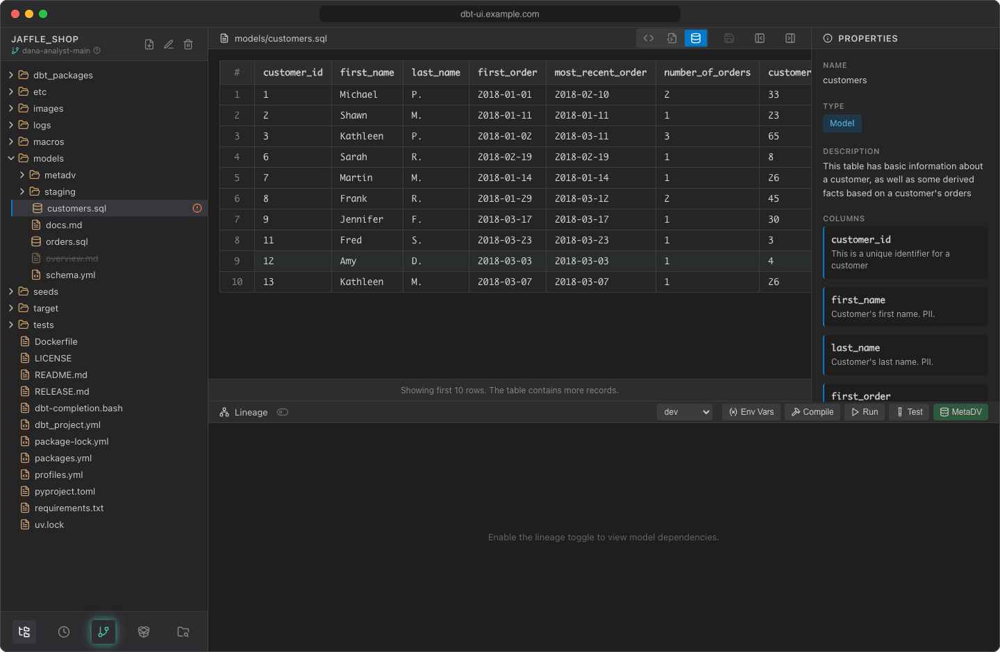

# Show data

Preview the rows of a model without leaving the editor. dbt UI runs `dbt show` for you and displays the first rows as a table.



## Before you start

- **Run the model first, in the same target.** The preview reads the table or view that dbt built for the model in your warehouse, in the target selected in the lineage panel. It doesn't execute the SQL in the editor, so unsaved edits, and saved changes you haven't run yet, aren't reflected. Ephemeral models have no table to read.
- **The project needs a manifest that knows the model.** Compiling or running the project creates it.
- **dbt-core 1.5 or later** is required, because older versions don't have `dbt show`.
- **Set your [env vars](env-vars.md)** if `profiles.yml` uses `env_var()`: the preview connects to the warehouse with them.

## Preview a model

1. Open a SQL model, a `.sql` file in a `models` folder.
2. Click **Preview data (dbt show)** in the editor header.
3. dbt UI asks "Load data from database?". Click **Load Data**.

A progress bar shows while the query runs. Then the table appears, with a `#` column numbering the rows and one column per column of the model. Empty (null) values show as blank cells.

If you click **Cancel** instead, the view shows "Data hasn't been loaded from database." with a **Load Preview Data** button.

## How the query runs

dbt UI runs:

```bash
dbt show --inline "select * from {{ ref('<model>') }}" --limit 11 --output json --target <target>
```

in your workspace, with your env vars. `<target>` is the target selected in the lineage panel ("Select dbt target"), and `ref()` resolves the model's database, schema and alias for that target, so you see the rows of the relation the model builds there. It fetches 11 rows and shows the first **10**. If there were more, the table ends with "Showing first 10 rows. The table contains more records." The number of rows isn't configurable.

The query has a timeout of **2 minutes**. The rows aren't written to the server's log.

## Refresh or reuse a preview

dbt UI remembers the last preview of each model, separately for each target, while the page is open. When you come back to **Preview data** for a model you've already previewed, it asks "Refresh data from database?":

- **Refresh** runs the query again.
- **Use Cached** shows the rows you loaded before.

Switching the target doesn't show another target's rows: a model you previewed only in another target has to be loaded again.

Reloading the page clears all cached previews.

## Common errors

Errors appear under "Failed to load preview:" with the message from dbt UI or dbt.

| Message | What to do |
| --- | --- |
| `manifest.json not found. Please compile the project first.` | Compile or run the project from the [lineage panel](running-dbt.md). |
| `Model '<name>' not found in manifest. Please compile the project.` | The model is new or renamed since the last compile. Compile again. |
| An error from the database saying the relation doesn't exist | The model hasn't been built in the selected target yet. [Run it](running-dbt.md) there first, or pick the target you ran it in. |
| A connection or authentication error from dbt | Check `profiles.yml` and the values in [Env vars](env-vars.md). |
| `Query timed out after 2 minutes` | The warehouse took too long to answer, for example because the model is a slow view. |
| `dbt show is not supported for dbt-core < 1.5` | Upgrade dbt-core (raise `require-dbt-version` and [recreate the virtual environment](../getting-started/first-project.md#3-create-the-virtual-environment)). |

## Previewing CSV files

CSV files, such as seeds, open in **Table view** without any query: dbt UI shows the file's own contents as a table. Switch to **Text view** to edit the file.
